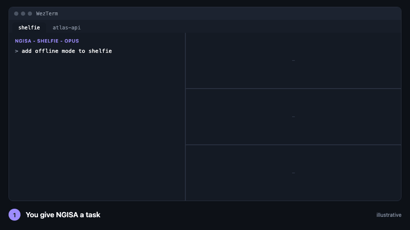

# NGISA

English | [Tiếng Việt](README.vi.md)

**Run several Claude Code agents in parallel on one repo. They write and test. You review and merge.**

NGISA (*NGƯỜI GIÁM SÁT*, "the supervisor") is one Claude Code session per repo that plans a task, hands the pieces to worker agents, checks that the gate was not touched, and stops at a draft PR for you.



*Illustrative mock-up, not a recording. The same layout as a real WezTerm tab.*

## What you get

- **Parallel, not chaotic.** Up to 3 workers per repo, each in its own git worktree, each on its own task.
- **A gate the workers cannot fake.** Every worker runs the repo's own `tool/setup.sh` and must pass `tool/ci_local.sh`. `gate-check`, a script, checks that the gate files and lint config were not touched. Flutter, Composer PHP and plain PHP repos get a gate generated for them.
- **You stay in charge.** You approve the plan and read the diff. Workers cannot push. Only you merge to `main`.

## Try it

You need macOS, [WezTerm](https://wezterm.org), `jq` and a recent Claude Code (`claude update`), plus `fvm` for Flutter repos and `composer` for PHP repos.

1. **Install the scripts** into `~/bin`, once per machine: steps 1 to 3 of [`lab-quickstart.md`](docs/orchestration/lab-quickstart.md).
2. **Make a lab copy and open the NGISA:**
   ```bash
   make-lab ~/Projects/<your-repo>
   repo-tab ~/lab/<your-repo>
   ```
3. **Give it a small task** with 2 independent parts, approve the plan, say `go`.

Done? `rm -rf ~/lab/<your-repo>`, or fetch a branch from it into the real repo.

## Learn more

- [Live diagram](https://khoa2001.github.io/ngisa/diagrams/ngisa-and-agent-wall.html) ([vi](https://khoa2001.github.io/ngisa/diagrams/ngisa-and-agent-wall.vi.html)): the window layout and the idea-to-merge flow on one page. Source: [`docs/diagrams/`](docs/diagrams/).
- [`one-terminal-orchestrator.md`](docs/orchestration/one-terminal-orchestrator.md) ([vi](docs/orchestration/one-terminal-orchestrator.vi.md)): the full design. Roles, hooks, human gates, plan limits.
- [`lab-setup.md`](docs/orchestration/lab-setup.md) and [`lab-quickstart.md`](docs/orchestration/lab-quickstart.md): try it in a throwaway copy without touching `~/.claude`.
- [`docs/README.md`](docs/README.md): index of every doc, the repo layout and the scripts.
- [`CONTEXT.md`](CONTEXT.md): goals, decisions so far, open items. Start here if you want to contribute.

<details>
<summary>Safety</summary>

- The lab clone's push URL is `DISABLED`, and `git push`, `pub publish`, `fastlane` and `firebase deploy` are denied. The one way out is `agent-pr`, which refuses `main`, `master`, the base branch, `worktree-*` names and dirty trees, and which Claude asks you to approve on every call.
- Nothing here touches `~/.claude` or your real repo.
- Do not run the NGISA or workers in bypass-permissions mode: agent reports to the NGISA then get held for approval. Use auto mode.
- Max 3 agents per tab. All agents share one usage quota.

</details>

## Status

Experimental. Each run is logged (time, interventions, gate-check FAILs, cost) under [`docs/runs/`](docs/runs/) as research data, from the "hand-off" project: can an agent system ship production-quality software from a spec, and where must a human stay in the loop?
