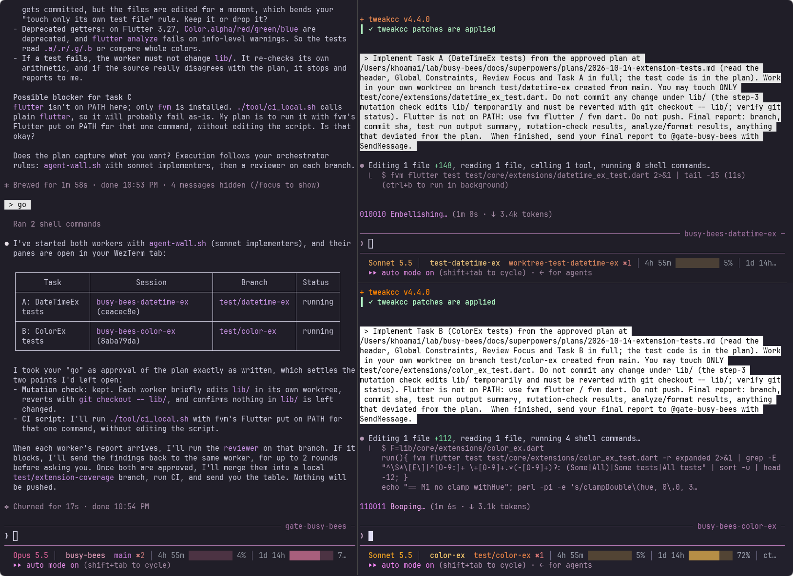

# NGISA

**NGISA** (*NGƯỜI GIÁM SÁT*, "the supervisor" in Vietnamese) is an orchestrator kit for running several Claude Code agents in parallel on one repo, plus the research behind it, from the "hand-off" project: can an agent system ship production-quality software from a spec, and where must a human stay in the loop?



*A real run on `~/lab/busy-bees` (the screenshot predates the name NGISA, so the session still reads `gate-busy-bees`). Left: the NGISA (Opus) plans, dispatches and reviews. Right: two Sonnet implementers, each in its own worktree, working on independent tasks.*

## How it works

One WezTerm window, one tab per repo. Each repo tab has one **NGISA** on the left and up to 3 **agent** panes on the right.

| Role | Model | Job |
|---|---|---|
| NGISA | Opus | Turns a spec into an approved plan, splits it into tasks, dispatches workers, runs reviews, reports one table. Never writes code. |
| Implementer | Sonnet | Does one task in its own worktree: TDD, `./tool/ci_local.sh` green, commit on its branch, report back. Never pushes. |
| Reviewer | Opus | Read-only. Checks one branch against the task and answers APPROVE or BLOCK. |

Flow: spec, plan (you approve), tasks, parallel implementers, reviewer per branch (BLOCK goes back to the same worker, 2 rounds max), merge into a local feature branch, CI, one report. Only you merge to main.

No custom framework: it uses Claude Code's own background sessions (`claude --bg`), subagents, worktrees and `claude agents`.

## Talking to NGISA

NGISA and the workers' reports answer in caveman ultra (terse, no filler) through a hook. Code, commits and PR text stay normal.

| You say | What happens |
|---|---|
| a normal task | brainstorm, plan, you approve, then workers |
| `quick: <one small edit in 1-2 files>` | skips the plan, one implementer on exactly those files, reviewer still runs |
| `have it carve` | NGISA messages that worker to run `/carve`; you answer its prompts in its pane |
| `open a PR` | after CI is green, NGISA runs `agent-pr` for a draft PR; Claude asks you to approve that command |

## What is in the repo

| Path | What |
|---|---|
| `agents/implementer.md`, `agents/reviewer.md` | Agent definitions |
| `orchestrating.md` | NGISA rules, copied to `CLAUDE.local.md` in a lab clone |
| `settings.local.json` | Permission allow and deny list (push and publish are denied) |
| `docs/` | Playbooks (English and Vietnamese), diagrams, run screenshot. Index in [`docs/README.md`](docs/README.md) |
| `CONTEXT.md` | Goals, hypotheses, decisions so far, open items. Start here |
| `CLAUDE.md` | Rules for agents working in this repo |

The kit files are generated from the docs, so change both together. Every doc has a Vietnamese copy (`*.vi.md`, `*.vi.html`).

## Docs

- [`one-terminal-orchestrator.md`](docs/orchestration/one-terminal-orchestrator.md) ([vi](docs/orchestration/one-terminal-orchestrator.vi.md)): the main design. Layout, roles, hooks, human gates, Max plan limits.
- [`lab-setup.md`](docs/orchestration/lab-setup.md): try it in a throwaway copy without touching `~/.claude`.
- [`lab-quickstart.md`](docs/orchestration/lab-quickstart.md): the copy-paste version of the lab setup.
- [`cut-verification-time.md`](docs/verification/cut-verification-time.md) ([vi](docs/verification/cut-verification-time.vi.md)): cutting the time spent checking agent output.
- [`ngisa-and-agent-wall.html`](docs/diagrams/ngisa-and-agent-wall.html) ([vi](docs/diagrams/ngisa-and-agent-wall.vi.html)): one-page diagram of the window layout and the idea-to-merge flow. Open in a browser.

## Quickstart

Needs macOS, [WezTerm](https://wezterm.org), `jq`, a recent Claude Code (`claude update`), `fvm` for Flutter repos and `composer` for PHP repos.

1. Follow steps 1 to 3 of [`lab-quickstart.md`](docs/orchestration/lab-quickstart.md) once per machine. They install six scripts into `~/bin`:
   - `make-lab <repo>`: clones the repo into `~/lab/<name>`, disables its push URL (adding the real remote as `upstream`), copies in the kit.
   - `repo-tab <dir>`: turns the tab you run it in into the NGISA for that repo (a new tab if that tab has several panes).
   - `agent-wall.sh`: called by the NGISA to start a worker and open its pane.
   - `agent-init`: detects the stack (Flutter, PHP) and adds the per-repo files (`tool/setup.sh`, `tool/ci_local.sh`, `.worktreeinclude`, `.claude/ngisa-settings.json`, a `.gitignore` line). Workers run those two scripts, so the agent prompts name no tool.
   - `agent-pr "<title>" "<body>"`: the only push path. Pushes the feature branch to `upstream` and opens a draft PR (`gh` for GitHub, `tea` otherwise). NGISA runs it only when you ask, and Claude asks you to approve each call.
   - `caveman-ultra-hook`: the hook that keeps NGISA and the workers' reports in caveman ultra. Code, commits and PR text stay normal.
2. Make the lab copy and open the NGISA:
   ```bash
   make-lab ~/Projects/<your-repo>
   repo-tab ~/lab/<your-repo>
   ```
3. In the NGISA tab, give it a small task with 2 independent parts, approve the plan, say `go`.
4. Throw the lab away with `rm -rf ~/lab/<name>`, or fetch a branch from it into the real repo.

## Safety

- The lab clone's push URL is `DISABLED`, and `git push`, `pub publish`, `fastlane` and `firebase deploy` are denied. The one way out is `agent-pr`, which refuses `main`, `master`, the base branch, `worktree-*` names and dirty trees.
- Nothing here touches `~/.claude` or your real repo.
- Do not run the NGISA or workers in bypass-permissions mode: agent reports to the NGISA then get held for approval. Use auto mode.
- Max 3 agents per tab. All agents share one usage quota.

## Status

Experimental. Each run is logged (time, interventions, BLOCKs, cost) under `docs/runs/` as research data. See `CONTEXT.md` for the hypotheses being tested and the open items.
