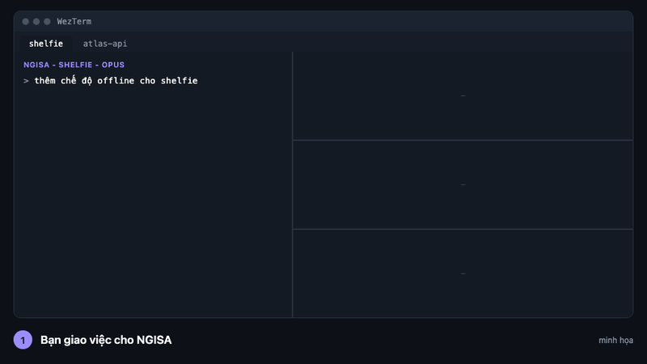

# NGISA

[English](README.md) | Tiếng Việt

**Chạy nhiều agent Claude Code song song trên một repo. Chúng viết code và test. Bạn review và merge.**

NGISA (*NGƯỜI GIÁM SÁT*) là một phiên Claude Code cho mỗi repo: lên plan cho task, giao từng phần cho các worker, kiểm tra gate không bị đụng, rồi dừng ở draft PR để bạn quyết định.



*Ảnh minh họa, không phải bản ghi thật. Bố cục giống một tab WezTerm thật.*

## Bạn được gì

- **Song song mà không loạn.** Tối đa 3 worker mỗi repo, mỗi worker có git worktree riêng và một task riêng.
- **Gate worker không thể làm giả.** Mỗi worker chạy `tool/setup.sh` của chính repo và phải qua `tool/ci_local.sh`. `gate-check` (một script) kiểm tra file gate và cấu hình lint không bị sửa. Repo Flutter, Composer PHP và PHP thuần được tạo sẵn gate.
- **Bạn nắm quyền.** Bạn duyệt plan và đọc diff. Worker không push được. Chỉ bạn merge vào `main`.

## Dùng thử

Cần macOS, [WezTerm](https://wezterm.org), `jq` và Claude Code bản mới (`claude update`), thêm `fvm` cho repo Flutter và `composer` cho repo PHP.

1. **Cài các script** vào `~/bin`, một lần cho mỗi máy: bước 1 đến 3 của [`lab-quickstart.md`](docs/orchestration/lab-quickstart.md).
2. **Tạo bản lab và mở NGISA:**
   ```bash
   make-lab ~/Projects/<your-repo>
   repo-tab ~/lab/<your-repo>
   ```
3. **Giao một task nhỏ** gồm 2 phần độc lập, duyệt plan, gõ `go`.

Xong thì `rm -rf ~/lab/<your-repo>`, hoặc fetch một nhánh từ lab về repo thật.

## Tìm hiểu thêm

- [Sơ đồ trực tiếp](https://khoa2001.github.io/ngisa/diagrams/ngisa-and-agent-wall.vi.html) ([en](https://khoa2001.github.io/ngisa/diagrams/ngisa-and-agent-wall.html)): bố cục cửa sổ và luồng từ ý tưởng đến merge trên một trang. Mã nguồn: [`docs/diagrams/`](docs/diagrams/).
- [`one-terminal-orchestrator.vi.md`](docs/orchestration/one-terminal-orchestrator.vi.md) ([en](docs/orchestration/one-terminal-orchestrator.md)): thiết kế đầy đủ. Vai trò, hook, các điểm người quyết định, giới hạn gói.
- [`lab-setup.md`](docs/orchestration/lab-setup.md) và [`lab-quickstart.md`](docs/orchestration/lab-quickstart.md) (bản tiếng Anh): thử trong một bản sao dùng xong bỏ, không đụng `~/.claude`.
- [`docs/README.md`](docs/README.md): mục lục mọi tài liệu, cấu trúc repo và các script.
- [`CONTEXT.md`](CONTEXT.md): mục tiêu, các quyết định đến giờ, việc còn mở. Đọc trước nếu muốn đóng góp.

<details>
<summary>An toàn</summary>

- Push URL của bản lab là `DISABLED`, và `git push`, `pub publish`, `fastlane`, `firebase deploy` đều bị chặn. Đường ra duy nhất là `agent-pr`: nó từ chối `main`, `master`, nhánh gốc, tên `worktree-*` và cây làm việc chưa sạch, và Claude hỏi bạn duyệt ở mỗi lần gọi.
- Không có gì ở đây đụng đến `~/.claude` hay repo thật của bạn.
- Đừng chạy NGISA hay worker ở chế độ bypass-permissions: báo cáo của agent gửi về NGISA sẽ bị giữ chờ duyệt. Dùng auto mode.
- Tối đa 3 agent mỗi tab. Mọi agent dùng chung một hạn mức.

</details>

## Trạng thái

Thử nghiệm. Mỗi lần chạy được ghi lại (thời gian, can thiệp, gate-check FAIL, chi phí) trong [`docs/runs/`](docs/runs/) làm dữ liệu nghiên cứu, thuộc dự án "hand-off": một hệ agent có giao được phần mềm chất lượng production từ một spec không, và con người phải ở đâu trong vòng lặp?
